# Data model

Status: **implemented** in migration `0001` (`backend/db/migrations/versions/0001_initial_schema.py`), 2026-10-23. Models: `backend/db/models.py`.

All timestamps are `timestamptz` in UTC. American odds are stored as integers. Fixed vocabularies (positions, sources, statuses, distribution families) are `text` with `CHECK` constraints instead of Postgres enums, so later migrations can add values without type changes.

## ERD

```mermaid
erDiagram
    teams ||--o{ games : "home / away"
    teams ||--o{ rosters : ""
    players ||--o{ rosters : ""
    players ||--o{ player_aliases : ""
    players ||--o{ prop_snapshots : ""
    players ||--o{ consensus_snapshots : ""
    players ||--o{ projections : ""
    players ||--o{ injuries : ""
    players ||--o{ depth_charts : ""
    players ||--o{ actual_stats : ""
    games ||--o{ prop_snapshots : ""
    games ||--o{ consensus_snapshots : ""
    games ||--o{ projections : ""
    games ||--o{ actual_stats : ""
    books ||--o{ prop_snapshots : ""
    markets ||--o{ prop_snapshots : ""
    markets ||--o{ consensus_snapshots : ""
    markets |o--o{ markets : "alternate of"
    scoring_configs ||--o{ projections : ""
    ingestion_runs ||--o{ prop_snapshots : ""
    players |o--o{ unmatched_names : "resolved to"

    teams {
        text abbr PK "nflverse abbreviation, e.g. KC"
        text name
        text conference
        text division
    }
    players {
        int id PK
        text full_name
        text position "QB RB WR TE (others allowed)"
        text team_abbr FK "current team, nullable"
        text gsis_id UK "nflverse, nullable"
        jsonb external_ids "sleeper, espn, yahoo, pfr, ... from load_ff_playerids"
        date birth_date
        timestamptz updated_at
    }
    rosters {
        int season PK
        int week PK
        int player_id PK
        text team_abbr FK
        text position
        text status "ACT RES INA ..."
        timestamptz available_at
    }
    player_aliases {
        int id PK
        text source "e.g. the_odds_api"
        text raw_name
        int player_id FK
        text method "exact normalized fuzzy manual"
        real score
        timestamptz created_at
    }
    unmatched_names {
        int id PK
        text source
        text raw_name
        text team_hint
        text position_hint
        text game_id FK
        int occurrences
        timestamptz first_seen
        timestamptz last_seen
        text status "open confirmed ignored"
        int resolved_player_id FK
    }
    games {
        text id PK "nflverse game_id, e.g. 2026_08_KC_LV"
        int season
        int week
        text season_type "REG POST"
        timestamptz kickoff_utc
        text home_abbr FK
        text away_abbr FK
        text odds_event_id UK "nullable until matched"
        real spread_line "home perspective, from nflverse"
        real total_line
    }
    books {
        text key PK "provider key, e.g. draftkings"
        text display_name
        real sharpness_weight "default 1.0"
        bool active
    }
    markets {
        text key PK "e.g. player_rush_yds"
        text stat "rush_yds, receptions, anytime_td ..."
        text distribution_family "lognormal gamma poisson negbin bernoulli"
        bool is_alternate
        text base_market_key FK "main market for _alternate keys"
    }
    prop_snapshots {
        bigint id PK
        timestamptz captured_at PK "hypertable time column"
        text game_id FK
        text book_key FK
        text market_key FK
        int player_id FK
        real line "null for anytime TD"
        int over_price "or Yes"
        int under_price "null when one-sided"
        text source "live historical"
        bytea payload_hash
        bigint ingestion_run_id FK
    }
    consensus_snapshots {
        bigint id PK
        timestamptz captured_at PK "hypertable"
        text game_id FK
        int player_id FK
        text market_key FK
        real fair_line
        real fair_p_over
        int books_count
        real dispersion
    }
    projections {
        bigint id PK
        timestamptz computed_at PK "hypertable"
        timestamptz as_of "inputs no later than this"
        text game_id FK
        int player_id FK
        int scoring_config_id FK
        real mean
        real p20
        real p80
        jsonb breakdown "per-stat mean, source, contribution"
        real confidence "0-1"
        text engine_version
    }
    scoring_configs {
        int id PK
        text key UK "ppr half_ppr standard"
        text name
        jsonb weights "validated against engine.scoring.ScoringWeights"
        bool is_builtin
    }
    injuries {
        int season PK
        int week PK
        int player_id PK
        text team_abbr FK
        text report_status "Out Doubtful Questionable"
        text practice_status
        text primary_injury
        timestamptz available_at PK
    }
    depth_charts {
        int season PK
        int week PK
        int player_id PK
        text team_abbr FK
        text position PK
        int depth_rank
        timestamptz available_at PK
    }
    actual_stats {
        text game_id PK
        int player_id PK
        int season
        int week
        int completions
        int pass_attempts
        int pass_yds
        int pass_tds
        int interceptions
        int rush_attempts
        int rush_yds
        int rush_tds
        int targets
        int receptions
        int rec_yds
        int rec_tds
        int fumbles_lost
        int two_pt_conversions
    }
    ingestion_runs {
        bigint id PK
        text kind "odds_live odds_historical nflverse"
        timestamptz started_at
        timestamptz finished_at
        text status "running ok partial failed"
        int events
        int quotes
        int new_snapshots
        int credits_used
        int credits_remaining
        jsonb errors
    }
```

## Key decisions

1. **Three hypertables:** `prop_snapshots`, `consensus_snapshots` and `projections`. All three grow with every poll and are queried by time. TimescaleDB requires the time column in every unique key, so their primary keys are `(id, captured_at)` / `(id, computed_at)`. Nothing references them by foreign key.
2. **No-leakage timestamps.** Rule 5 says the engine must work at any historical `as_of`. So every fact that arrives over time (`rosters`, `injuries`, `depth_charts`) carries `available_at`: when it became public. That's the source's own timestamp when nflverse has one, or the time we captured it. Backtests filter on it. Injury and depth-chart rows are kept per change, not overwritten, so the history survives.
3. **Weekly `rosters` table (added).** It isn't in the step's entity list, but the resolver needs "who was on these two teams that week" to handle a player traded mid-season, and `/p2-nflverse` loads weekly rosters anyway.
4. **Snapshot series and dedupe.** A series is `(game, book, market, player)` for main markets, plus `line` for `_alternate` markets (each threshold is its own series). `payload_hash` = SHA-256 of the series key plus line and prices. `db/snapshots.py` gets an insert helper that skips a quote when its hash matches the latest row in its series. It's tested against the test database here, and `/p2-scheduler` will use it.
5. **Indexes.** `(player_id, market_key, book_key, captured_at DESC)` serves both "latest snapshot per player/market/book" and "time series for one player/market". `(game_id, captured_at DESC)` serves per-game sweeps. Postgres can read either index in both directions.
6. **Hourly consensus.** The continuous aggregate `consensus_hourly` is built over `consensus_snapshots`: `time_bucket('1 hour')` per player/market, with `last()` fair line and P(over), average dispersion, and max books. De-vigging can't happen in SQL, so the hourly rollup aggregates the consensus rows that `/p3-consensus` writes. It's created `WITH NO DATA` in real-time mode (`materialized_only = false`), so the current hour appears before the next refresh. A policy refreshes the last 3 days every 30 minutes.
7. **Aliases.** Unique on `(source, raw_name, player_id)`, not `(source, raw_name)`. Two different players can share a sportsbook name (two "Mike Williams"), so the resolver picks among them using the game's rosters.
8. **Scoring weights as JSONB**, validated by a pydantic model in `engine/scoring.py`. The model is pure, with no I/O. JSONB keeps per-position overrides (TE premium) and 6-point passing TDs possible without schema changes, which the `/p3-projection` tests need.
9. **Migrations.** Hand-written, because hypertables and continuous aggregates need raw SQL. SQLAlchemy models mirror them, and `alembic check` runs in CI to catch drift between the two.

## Seed data (`make seed`, safe to rerun)

- **Teams:** all 32.
- **Books (US region):** draftkings, fanduel, betmgm, williamhill_us (Caesars), espnbet, fanatics, betrivers, betonlineag, bovada, lowvig, mybookieag, betus. All start at `sharpness_weight = 1.0`; which books count as sharp is still an open decision.
- **Markets:** pass yds, pass TDs, pass completions, interceptions, rush yds, rush attempts, receptions, receiving yds, anytime TD, plus `_alternate` variants for pass yds, pass TDs, rush yds, receptions and receiving yds. These keys are provisional: `/p2-odds-adapter` confirms them against the provider's market list.
- **Scoring configs:** `ppr`, `half_ppr` and `standard`, from the formula in `docs/PLAN.md` §4: 0.04/pass yd, 4/pass TD, −2/INT, 0.1/rush or rec yd, 6/TD, r/reception, −2/fumble lost, 2/two-point conversion.

## Tests

- Migrations: upgrade to head → downgrade to base → upgrade again, against `propline_test`. Checks that the three hypertables and the continuous aggregate exist after upgrade and are gone after downgrade.
- Seed: loads, a second run changes nothing, and the three scoring configs pass the weights model.
- Dedupe helper: an unchanged quote is skipped; a price change, a line change and a new alternate threshold are each stored.
- These tests need Postgres, so they're marked `db` and use `TEST_DATABASE_URL`. CI already runs TimescaleDB.

## Added in migration 0002 (`/p2-nflverse`)

- **`snap_counts`**: per-game offense, defense and special-teams snaps and percentages, keyed by `(game_id, player_id)`. Players are matched by their Pro Football Reference id. Offensive linemen and long snappers often aren't in nflverse's fantasy id list, so their rows are skipped.
- **`ff_rankings`**: FantasyPros weekly positional expert consensus rankings (`ecr`, `sd`, `best`, `worst`), unique on `(scrape_date, page_type, fantasypros_id)`. Each is assigned to the week in progress on its scrape date. `player_id` is null for players not on a loaded roster.
- **`ingestion_runs.details`**: JSONB with per-run parameters and row counts.

### `ingestion_runs` for live odds (`kind = 'odds_live'`)

One row per `run-ingest` run that polled anything: `events` is games polled, `credits_used` and `credits_remaining` come from the provider, and `errors` lists failed games. `details` holds:

- `tier`: `auto` or the forced interval.
- `games`: for each game polled successfully, `event_id`, `polled_at`, `quotes`, `new_snapshots` and `unmatched_names`. The next run reads `polled_at` to decide which games are due, so a failed poll is retried at once.
- `deferred`: games left unpolled because the daily credit budget ran out.
- `unmatched_names`, `one_sided_quotes`, `unknown_market_quotes` and `new_books`: counts and names worth reviewing.

Status is `ok`, `partial` (some games failed or were deferred) or `failed` (none succeeded). Runs with nothing due, or with the budget already spent, create no row.

### `backfill_progress` and historical runs (`kind = 'odds_historical'`)

`backfill_progress` has one row per `(game_id, label)`, where the label is `open`, `t72h`, `t24h`, `t6h`, `t1h` or `close`. A row means that snapshot is finished, so reruns skip it:

- `status`: `done`; `empty` (the provider had no props at that time: free, and not asked again); or `stale` (the closest snapshot was more than `STALE_QUOTE_MINUTES` before the target; the data is stored, but a backtest can skip it).
- `target_at` is the time we asked for, and `snapshot_at` is when the provider says its snapshot was taken. They differ by up to five minutes, or more when a snapshot is stale or covers several targets.
- `credits` is what the call cost. A call that satisfied several labels (the open search lands on a fixed target, or two targets share a snapshot) is billed once.

Backfill runs are recorded in `ingestion_runs` as `odds_historical`, with `details` holding the seasons, labels, markets, call count, status counts and why it stopped, if it did (`credit cap` or `reserve`). Their credits are not counted against the daily live budget.

Historical rows in `prop_snapshots` have `source = 'historical'` and `captured_at` equal to the provider's snapshot time. Each is compared with the row before it in time, so adding earlier snapshots after later ones still leaves "the latest quote at or before T" correct.

### Distribution families

`markets.distribution_family` is the family the fitted shapes use: gamma for passing, rushing and receiving yards, negative binomial for completions and rush attempts, Poisson for pass TDs, interceptions and receptions, and bernoulli for anytime TD (a Poisson count with lambda = -ln(1 - p)). `make seed` updates it; see `docs/DISTRIBUTION_SHAPES.md` for the evidence.

### Keep-alive rows and `consensus_snapshots`

Storing only changes would make a quiet book look stale, so an unchanged quote is stored again once the series' last row is `QUOTE_KEEPALIVE_MINUTES` (45) old. A book that keeps quoting therefore always has a row under 45 minutes old; one that pulled the market stops getting rows and drops out of the consensus after `STALE_QUOTE_MINUTES` (90). Snapshots hours apart (the backfill) store every row for the same reason: "the latest row per series at or before T" then means "still listed at T".

`consensus_snapshots` has one row per `(game, player, main market)` each time the consensus changes, with `captured_at` the moment it was computed as of:

- `fair_line` is the weighted median of the lines the books posted (NULL for markets without a line), and `fair_p_over` is the probability of the over at that line.
- `books_count` is the number of books used. `dispersion` is the weighted spread of how far each book's line would have to move to match, in the market's own units (yards, receptions), or in probability points when there is no line. NULL with a single book.
- Alternate-line markets get no consensus row; `/p3-projection` will feed their thresholds to the distribution fit directly.
- When books post different lines, each is shifted to the reference line with the stat's fitted distribution for the player's position (`backend/config/distribution_params.json`), or a stand-in normal curve if the stat or position has no fitted shape.

### How `available_at` is set by the nflverse loaders

| Data | `available_at` |
| --- | --- |
| Injuries through 2024 | `date_modified` from nflverse |
| Injuries from 2025 (no `date_modified`) | 1 day before that team's kickoff, after the final report |
| Depth charts from 2025 | the snapshot's `dt`; only rank changes are stored |
| Depth charts through 2024, weekly rosters | 3 days before that team's kickoff |

Weekly rosters keep only players on the team (`ACT`, `RES`, `INA`, `DEV`). Rows for traded, cut or retired players are dropped.

## Not in this step

Compression and retention policies, the `movement` and `market_events` tables (Phase 4), and users, watchlists and alerts (Phase 6).
