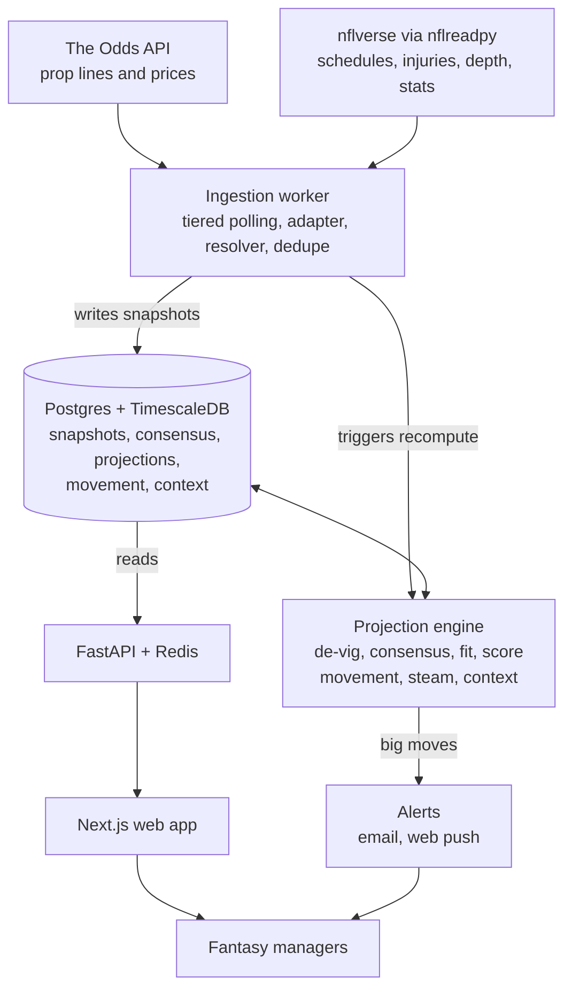

# Plan — Prop-Line Fantasy Projections

As of 2026-10-23. Source of truth for *why* and *how*; `docs/ROADMAP.md` is the *order*; `CLAUDE.md` holds the rules.

## 1. Concept

The app turns US sportsbook player-prop lines into market-implied fantasy projections, and treats line movement as the earliest signal that a projection should change.

**Thesis.** A prop line plus its over/under prices is the market's estimate of a player's stat distribution. Combining a player's passing, rushing, receiving, reception and TD props yields an expected fantasy score that already reflects injuries, weather, game script and sharp money — often hours before traditional projection sites update. Movement from open to current shows which way that information is pushing.

**Users.** Season-long managers (start/sit, waivers, trades) and DFS players who want a market-based baseline.

**v1 scope** — see `CLAUDE.md`.

## 2. Data sources

| Need | Source | Notes |
| --- | --- | --- |
| Current player-prop lines, US books | The Odds API event-odds endpoint | One game per call; cost = markets × regions credits |
| Historical props for backtesting | The Odds API historical endpoints (paid) | Props back to May 2023 |
| Milestone props (e.g. 100+ rush yds) | `_alternate` market keys | Pins down distribution tails |
| Schedules, weekly rosters, injuries, depth charts, snap counts | nflreadpy | Polars, cached |
| Actual stats for grading | nflreadpy `load_player_stats()` | Ground truth |
| Player ID mapping | nflreadpy `load_ff_playerids()` | Bridges sportsbook names to canonical IDs |
| Baseline rankings | nflreadpy `load_ff_rankings()` | Backtest comparison |

**Credit budgeting.** 8 prop markets × 1 region = 8 credits per game per pull. A 16-game slate pulled hourly = 128 credits per sweep. Tier polling by time to kickoff and store every snapshot locally rather than re-buying history.

**Alternatives** if coverage/latency/history fall short: OddsPapi, SportsGameOdds, TheRundown, OpticOdds. Keep the provider behind an adapter.

**Licensing.** Most nflverse data is CC-BY 4.0; FTN charting is CC-BY-SA 4.0. Check each odds provider's terms on displaying or redistributing data before a public launch. If sportsbook links or affiliate deals are added, state advertising and responsible-gaming rules apply.

Sources: https://the-odds-api.com/sports/nfl-odds.html · https://pypi.org/project/nflreadpy/

## 3. Architecture

Every projection traces back to stored prop snapshots.



Keep `engine/` a pure library so the same code runs live and in backtests.

## 4. Projection methodology

1. **De-vig each book.** Over/under prices → implied probabilities → remove hold (multiplicative first; also power and Shin) → fair P(over) at that book's line.
2. **Consensus.** Combine books into one fair line and P(over), weighting sharper / fresher books more and dropping stale quotes.
3. **Fit a distribution per stat.**
   - Yardage: skewed continuous (log-normal or gamma) with a point mass at zero for low-volume players, solved so P(X > line) = fair P(over). Alternate lines pin down shape.
   - Counts (receptions, pass TDs, completions, INTs): Poisson or negative binomial.
   - Anytime TD: λ = −ln(1 − P(TD)). Do not also add separate rush/rec TD props.
4. **Use means, not lines.** Lines sit near the median; yardage is right-skewed, so the mean is above the line.
5. **Score.** Apply the league's scoring weights to stat means.
6. **Fill gaps.** No prop for a stat → team implied total (spread + total) × trailing usage share; flag low confidence.
7. **Range.** v1: per-stat p20/p80 assuming independence. v2: Monte Carlo with QB–pass-catcher correlation.

Standard scoring, r = 1 (PPR), 0.5 (half), 0 (standard):

```
E[FP] = 0.04·PassYds + 4·PassTD − 2·INT + 0.1·(RushYds + RecYds) + 6·TD + r·Rec − 2·FumLost
```

Fumbles lost have no market — use the player's historical rate. All weights come from `scoring_configs`.

**Movement signals**
- Projection change since open and over 1h / 6h / 24h, attributed to the driving prop
- Book agreement: share of books moving the same direction
- Steam: several books moving within minutes
- Context join: moves matched to injury, depth-chart and weather updates by timestamp

**Validation.** Backtest 2023–2025 against actual box scores: MAE, within-position rank correlation, p20/p80 coverage; compare against `load_ff_rankings()`.

## 5. Risks

| Risk | Effect | Mitigation |
| --- | --- | --- |
| Few/no props for backups and WR3s | Missing where start/sit is hardest | Gap filling, low-confidence labels |
| Retail books shade lines toward popular overs | Projections biased high | Weight sharper books; measure and correct bias in backtest |
| Provider terms restrict redistributing odds | Can't show raw lines | Show derived projections and fair probabilities; confirm terms early |
| Credit cost scales with markets × games × polls | Budget overruns | Tiered polling, dedupe, hard daily budget |
| Late scratches after the last poll | Stale projection at lock | 15-min polling inside 3h; inactive-list checks |
| Player name mismatches | Silent data loss | Resolver queue, unmatched-rate monitoring |

Open decisions are tracked at the bottom of `docs/ROADMAP.md`.
